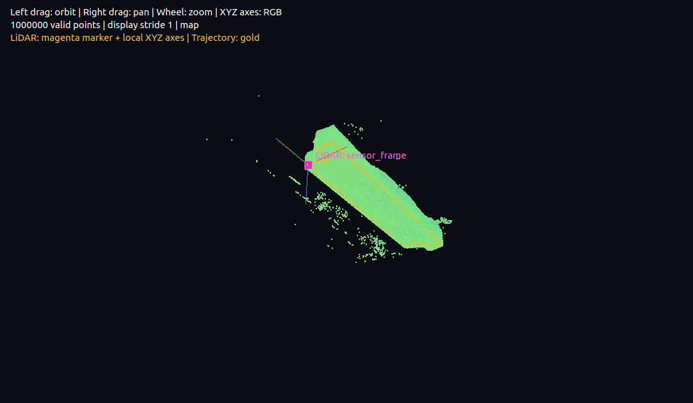
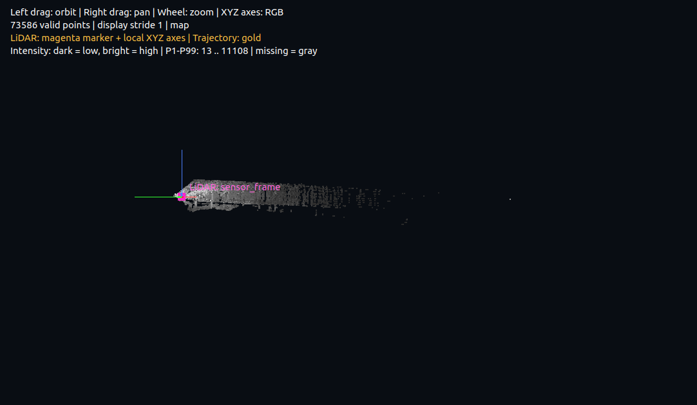

[](README.md)
[](README.zh-TW.md)

# CloudTrail bag viewer

A ROS-free C++ viewer for ROS1 bag point clouds, featuring voxel accumulation, odometry tracking, intensity coloring, and PLY export.

CloudTrail parses **ROS1 bag v2.0** files and `sensor_msgs/PointCloud2` messages directly in C++17, with Qt5 and OpenGL for visualization. By default, it accumulates clouds up to the selected frame and downsamples them into **5 cm voxels**. The default point cloud topic is `/cloud_registered`. ROS, PCL, and RViz are not required.



## Installation requirements

### Operating system and dependencies

The project has been built and tested on **Ubuntu 22.04.5 LTS**. The instructions below use Ubuntu/Debian `apt` package names; other versions have not been individually validated. The compiler must support **C++17**, and the current build uses **Qt5**.

| Package | Purpose | Tested component version |
| --- | --- | --- |
| `build-essential` | C++ compiler, Make, and basic build tools | GCC / G++ 11.4.0 |
| `cmake` | Configure and build the project; run CTest | CMake 3.22.1 |
| `qtbase5-dev` | Qt5 Widgets, Gui, and development files | Qt 5.15.3 |
| `libgl1-mesa-dev` | OpenGL headers and development libraries for linking | The viewer requests an OpenGL 2.1 compatibility context |
| `libbz2-dev` | Decompress bag chunks using `bz2` | BZip2 1.0.8 |
| `liblz4-dev` | Decompress bag chunks using `lz4` | LZ4 1.9.3 |

**You do not need to install ROS, PCL, or RViz, or source a ROS `setup.bash`.** BZip2 and LZ4 development packages are required at build time even if your bag is uncompressed, because the executable includes both decompression paths.

### Install the required packages

Run the following commands in a terminal. `sudo` may prompt for your system account password.

```bash
sudo apt update
sudo apt install -y \
  build-essential \
  cmake \
  qtbase5-dev \
  libgl1-mesa-dev \
  libbz2-dev \
  liblz4-dev
```

Doxygen is optional and is used only to generate source documentation. **It is not required to build or run the viewer.** To generate documentation, install it separately with `sudo apt install doxygen`; see [Doxygen documentation](#doxygen-documentation).

### Desktop visualization and headless operation

- **3D visualization, screenshots, and playback benchmarks:** require a working Linux desktop display environment (X11 or Wayland) and a graphics driver capable of creating an OpenGL 2.1 compatibility context. Launch the viewer from a terminal in that desktop session.
- **Headless inspection and export:** `--info`, `--validate`, `--export`, `--export-all`, and `--export-all-raw` work on servers or SSH sessions without a desktop. They do not create an OpenGL window. The Qt, OpenGL, and other libraries listed above are still required because these modes use the same executable.
- **Input data:** requires an indexed ROS1 bag v2.0 `.bag` file. ROS2 `.db3` and MCAP are not supported. Sample `.bag` files are excluded by `.gitignore`, so you must provide your own data after obtaining the repository. Place the bag in the project root or pass its full path.

## Build and run

### 1. Enter the project root

Run the following commands from the directory containing `CMakeLists.txt`. For example, if the project is under `~/codebases/`:

```bash
cd ~/codebases/cloudtrail-bag-viewer
```

Replace this path with the actual location if you downloaded the project elsewhere.

### 2. Configure and build

```bash
cmake -S . -B build -DCMAKE_BUILD_TYPE=Release
cmake --build build -j2
```

The first command checks dependencies and generates build files in `build/`. The second builds with two parallel jobs. The resulting executable is `build/bag_cloud_viewer`. Use `Release` for optimized point cloud decoding, accumulation, and playback.

The `build/` directory is excluded by `.gitignore` and does not need to be uploaded to GitHub.

### 3. Run regression tests

```bash
ctest --test-dir build --output-on-failure
```

The tests generate their own small messages and bag fixtures. **No large bag file or desktop environment is required.** A successful run reports `100% tests passed`.

### 4. Launch the viewer

The following examples assume `2026-09-15-00-36-37.bag` is in the project root. Start from the first frame:

```bash
./build/bag_cloud_viewer 2026-09-15-00-36-37.bag
```

Build and display the accumulated map from the entire bag:

```bash
./build/bag_cloud_viewer 2026-09-15-00-36-37.bag --all
```

Check that the bag can be read in a headless environment:

```bash
./build/bag_cloud_viewer 2026-09-15-00-36-37.bag --info
```

The default point cloud topic is `/cloud_registered`, with message type `sensor_msgs/PointCloud2`. For another topic, add `--topic /your_cloud_topic`. See [Command-line examples](#command-line-examples) for other visualization and export options.

### Installation troubleshooting

| Issue | Resolution |
| --- | --- |
| CMake cannot find `Qt5Config.cmake` | Install `qtbase5-dev` and rerun CMake configuration. The project currently uses Qt5. |
| OpenGL, BZip2, or LZ4 cannot be found | Ensure `libgl1-mesa-dev`, `libbz2-dev`, and `liblz4-dev` are installed. The development packages are required. |
| An SSH session or server cannot connect to a display or create an OpenGL context | Use a headless mode listed above. Visualization requires a working desktop session and graphics driver. |
| CMake reports a source/build path mismatch after moving the project | The old `build/` contains absolute paths. Configure a new directory, for example with `-B build-new`, build with `cmake --build build-new -j2`, and then run `./build-new/bag_cloud_viewer`. |

Normal startup begins at the first frame and accumulates clouds during playback. The accumulated range always runs from frame 0 through the selected frame. Seeking backward rebuilds the map up to that frame; selecting the same frame again does not accumulate it twice.

The initial view and `Fit view` use **map +Z up, +Y left, and a viewing direction along +X**. The camera starts on the −X side of the point cloud center. Rotation keeps Z up and limits pitch to ±89° to prevent inversion.

Viewer controls:

| Control | Action |
| --- | --- |
| Left mouse drag | Orbit the camera |
| Right mouse drag | Pan the camera |
| Mouse wheel | Zoom |
| Play / Pause | Advance bag time using elapsed wall time and the selected rate, or pause |
| Previous / Next | Previous/next frame; Previous is disabled in accumulated mode and enabled in single-frame mode |
| Frame slider | Seek on release and accumulate through the selected frame |
| LiDAR pose | Show the current LiDAR position in magenta and its orientation axes |
| Trajectory | Show the odometry trajectory through the current frame in gold |
| Accumulate (5 cm) | Switch between the accumulated cloud and the original single frame |
| Load all frames | Load the entire bag and display the accumulated map |
| Export all frames... | Export the entire bag, regardless of the current slider position |
| Export mode selector | 5 cm voxel centers: complete voxel map; All original XYZ + intensity: all original valid XYZ points and intensities |
| Fit view | Fit the current cloud into the view |
| Fit every frame | Refit the camera whenever the frame changes |
| Height color / Single color / Intensity (grayscale) | Color by Z height, use a single color, or display reflectance intensity as grayscale |
| 0.25x, 0.5x, 1x, 2x, 4x, 8x, 16x | Playback rate |

The XYZ axes are red, green, and blue, respectively, and are located at the data origin. Accumulated mode retains a uniform reservoir sample of up to one million voxel centers for display by default; adjust this with `--max-points`. Original single frames use an evenly spaced stride when they exceed the display limit. During playback, drawing is temporarily limited to 200,000 points. Pausing restores the limit specified by `--max-points`. **Display limits do not reduce the complete voxel map or exported point count.**

Accumulation uses a 5 × 5 × 5 cm grid. Each occupied cell is represented by its center, rather than the mean position of its points, and retains the intensity of the first point received in that cell. Each 8 × 8 × 8 voxel block uses 512 occupancy bits. Intensities are stored compactly only for occupied cells, rather than allocating 512 floats per block. Map memory still grows as more space is explored; it is not a fixed-capacity cache.

## Playback timing and performance

Playback uses a monotonic wall clock to compute the target bag time: `target = playback start + elapsed wall seconds × rate`. Processing time is no longer followed by an additional full frame interval, which previously caused timing drift. The speed selector and scheduler share the same rate definitions.

At high rates, the display updates at approximately 30 Hz at most and shows the latest frame whose timestamp has become due. **Accumulated mode still reads every intermediate frame in order**; only display updates are combined. Each playback accumulation batch yields to the event loop after approximately 50 ms to keep the UI responsive when catching up. Pausing and resuming, or seeking, establishes a new time anchor. Changing rates preserves continuity of the target time.

The status line shows `speed actual rate / selected rate`, averaged over the current playback segment or since the most recent rate change. `lag` is the number of bag seconds behind the target time. If disk access or accumulation exceeds the machine's processing capacity, actual speed may remain below the requested rate; these values make that visible.

Run an approximately five-second playback benchmark, print the measurements, and exit. This requires a graphical environment:

```bash
./build/bag_cloud_viewer 2026-09-15-00-36-37.bag --playback-rate 16 --benchmark-seconds 5
```

Local measurements with the default display settings:

| Test | Actual rate |
| --- | --- |
| Before the timing fix: 16x, starting at frame 0 | 4.83x |
| After the timing fix: 16x, starting at frame 0 | 15.90x |
| After the timing fix: 8x, starting at frame 0 | 7.96x |
| After the timing fix: 16x, starting at frame 2000 with intensity coloring | 15.90x |

These are approximately five-second GUI measurements and depend on system load. Benchmark output includes actual wall time, bag time advanced, starting and ending frames, paint count, accumulated frame count, and input point count.

## LiDAR pose and trajectory

The viewer parses `nav_msgs/Odometry` from `/Odometry` directly, without ROS. A magenta marker indicates the current position and is labeled with `child_frame_id`. Local red, green, and blue axes indicate the LiDAR X, Y, and Z directions, with a red arrow pointing along +X. A gold line shows the trajectory through the matched odometry sample. Pose overlays remain visible over dense point clouds.

Matching uses the point cloud and odometry **Header.stamp**, not bag recording time. The nearest sample is selected, with ties resolved in favor of the earlier sample. If the time difference exceeds 0.2 seconds, or the odometry `header.frame_id` differs from the point cloud frame, the pose is hidden and the status line explains why. Trajectory segments do not connect across different parent or child frames. No TF transformation or additional extrinsic compensation is applied; the displayed pose is that of the odometry `child_frame_id`.

Playback, slider seeks, single-frame mode, and accumulated mode update the pose and trajectory together. The status line shows XYZ position in meters and the matching time difference. PLY export contains point cloud XYZ and intensity, not the displayed trajectory or axes.

Optional arguments:

```bash
# Select the odometry topic name
./build/bag_cloud_viewer 2026-09-15-00-36-37.bag --odom-topic /Odometry

# Skip pose and trajectory loading
./build/bag_cloud_viewer 2026-09-15-00-36-37.bag --no-odometry
```

Clouds can still be viewed when the odometry topic is missing. The stored odometry track retains position, orientation, timestamp, and frame names, but not covariance or twist. Quaternions are normalized during decoding; invalid position or rotation data is rejected.

## Intensity coloring and storage

Select **Intensity (grayscale)** in the color selector, or choose the initial mode from the command line:

```bash
./build/bag_cloud_viewer 2026-09-15-00-36-37.bag --all --color intensity
```



- The decoder reads the scalar PointCloud2 field named `intensity`, supporting all eight PointField numeric types and both byte orders. Values are converted to float32 in memory and output. The test bag uses FLOAT32 at offset 32.
- Single-frame mode uses each point's original intensity. The 5 cm accumulated map retains the intensity of the **first point** in each voxel, not an average or maximum. Display samples and complete exports use the same representative intensity for each voxel.
- Contrast uses the 1st and 99th percentiles of the displayed data. During playback, these are estimated at most once every 0.2 seconds from at most 65,536 evenly spaced samples; pausing recalculates them from the complete display sample. Logarithmic grayscale makes lower intensities darker and higher intensities brighter. Colors saturate outside the displayed range, which is shown in the viewer. This affects coloring only: **exported values are not normalized, clipped, or rewritten**.
- Missing intensity fields and NaN/Inf intensities do not remove otherwise valid XYZ points. Their intensity is stored as NaN and displayed in medium gray. If no finite intensity is available in the displayed data, the viewer shows a message.

PLY supports additional scalar properties, so conversion to PCD is unnecessary. All newly exported single-frame ASCII, original binary, and voxel binary PLY files include:

```text
property float x
property float y
property float z
property float intensity
```

Binary output uses 16 bytes per point: four little-endian float32 values in that order. Import software must preserve or expose custom scalar properties to show `intensity`. If an imported file appears to contain geometry only, check whether the importer ignores extra fields. Format reference: [Library of Congress PLY format description](https://www.loc.gov/preservation/digital/formats/fdd/fdd000501.shtml).

## Command-line examples

Frame indices start at **0**. `--info`, `--validate`, `--export`, `--export-all`, and `--export-all-raw` do not open a window and can run without a desktop.

```bash
# Inspect a frame's dimensions, timestamp, and coordinate frame
./build/bag_cloud_viewer 2026-09-15-00-36-37.bag --info --frame 100

# Decode and validate every frame on the selected topic
./build/bag_cloud_viewer 2026-09-15-00-36-37.bag --validate

# Export one frame as ASCII PLY with XYZ and intensity
./build/bag_cloud_viewer 2026-09-15-00-36-37.bag --frame 100 --export frame100.ply

# Accumulate the entire bag into 5 cm voxels and export binary PLY
./build/bag_cloud_viewer 2026-09-15-00-36-37.bag --export-all all_clouds_5cm.ply

# Stream every original valid XYZ point and its intensity to binary PLY
./build/bag_cloud_viewer 2026-09-15-00-36-37.bag --export-all-raw all_clouds_raw.ply

# Display individual original frames
./build/bag_cloud_viewer 2026-09-15-00-36-37.bag --single-frame

# Select a topic and display point limit
./build/bag_cloud_viewer 2026-09-15-00-36-37.bag --topic /cloud_registered --max-points 200000

# Capture the 3D view and exit; requires a desktop and OpenGL
./build/bag_cloud_viewer 2026-09-15-00-36-37.bag --frame 100 --screenshot preview100.png
```

Both whole-bag export modes include XYZ and intensity, but not RGB, per-point timestamps, or other fields. Original export retains duplicate points across frames; voxel export writes one point per occupied cell. Whole-bag exports are written to a temporary file in the destination directory and replace the destination only after completion. Original export supports cancellation and removes the temporary file. Accumulation in the GUI can also be canceled, retaining the map through the last completed frame.

## Implementation and supported formats

- `src/bag.hpp`, `src/bag.cpp`: standalone bag and PointCloud2 parsing without Qt; reusable interfaces include `bag::Reader`, `bag::Cloud`, and `bag::writePly`.
- `src/playback.hpp`: monotonic playback anchors, continuous rate changes, and due-frame lookup.
- `src/intensity.hpp`: finite intensity statistics, P1/P99 contrast ranges, and display normalization.
- `src/odometry.hpp`, `src/odometry.cpp`: odometry matching by message timestamp, retaining position and orientation tracks.
- `src/accumulation.hpp`, `src/accumulation.cpp`: blocked voxel maps, accumulation control, and streaming binary PLY export.
- `src/main.cpp`: Qt5/OpenGL viewer and command-line interface.
- Startup reads bag record headers, connection metadata, and indices rather than loading the entire 2.3 GB file. A chunk is loaded and decompressed only when needed, with one chunk cached at a time.
- Supports `none`, `bz2`, and standard ROS LZ4 frame compression. Message indices are sorted by bag recording time.
- XYZ decoding follows PointField names, offsets, and datatypes, supporting all eight numeric types, both byte orders, and `point_step`/`row_step` padding. Nonfinite XYZ values are filtered. XYZ is not assumed to be tightly packed or to occupy only 12 bytes per point.
- Accumulation and whole-bag export require matching frame IDs. The test data uses `map`. No TF is applied, so mismatched frames produce an error. Height and intensity colors are display effects; intensity is retained, while RGB is not read.
- Requires an indexed, properly finalized ROS1 bag v2.0 file. ROS2 `.db3`, MCAP, and repair of damaged bags are not supported. Individual record and chunk allocations are limited to 512 MiB.
- Playback follows bag recording time and elapsed wall time. Late display updates are combined while accumulation processes all intermediate frames. The displayed `stamp` comes from the message Header and may differ from bag recording time.

## Validation results

Test file: `2026-09-15-00-36-37.bag`. Topic: `/cloud_registered`.

| Item | Result |
| --- | --- |
| Message type | `sensor_msgs/PointCloud2` |
| Fully decoded frames | 5,317 |
| Bag recording time span | Approximately 531.571 seconds |
| Valid XYZ points across all frames, before deduplication | 50,264,043 |
| First-frame dimensions | 7,796 × 1 |
| First-frame point_step | 48 bytes |
| First-frame intensity | FLOAT32, offset 32, range 7–11,472 |
| First-frame coordinate frame | `map` |
| Odometry messages | 5,317 |
| Odometry parent → child | `map` → `sensor_frame` |
| Clouds matched to odometry | 5,317 / 5,317 |
| Maximum Header.stamp matching difference | 0 seconds |
| Complete voxel count after 5 cm downsampling | 24,971,805 |
| Voxel PLY size | 399,549,039 bytes, approximately 381 MiB, including intensity |
| Original XYZ PLY size | 804,224,847 bytes, approximately 767 MiB, including intensity |
| Peak RSS for accumulation and voxel export | Approximately 283 MiB, retaining intensity and the default one-million-point display sample |
| Peak RSS for streaming original XYZ export | Approximately 18 MiB |

The OpenGL viewer was launched with the complete accumulated cloud to capture the preview above. Memory figures were measured locally with `/usr/bin/time` during command-line exports; they exclude the GUI and GPU overhead. The local test run generated `all_clouds_5cm.ply`. Run the regression tests with:

```bash
ctest --test-dir build --output-on-failure
```

Tests cover byte order, field reordering, row padding, NaN filtering, truncated messages, bag indices, cross-chunk random access, and none/bz2/LZ4 compression. They also cover positive and negative voxel/block boundaries, accumulation seeks and cancellation/resume, duplicate prevention, complete export independent of display limits, binary PLY contents, and preservation of existing files when original export is canceled. Intensity tests cover numeric types, byte order, missing values, invalid fields, voxel intensity correspondence, PLY storage, and display ranges. Playback tests cover absolute timing, catching up after a stall, irregular/duplicate timestamps, rate changes, and re-anchoring. Odometry tests cover decoding, quaternion normalization, invalid messages, cross-chunk indexed reads, nearest-time matching, tolerance, and coordinate-frame checks.

Format references: [ROS Odometry message definition](https://github.com/ros/common_msgs/blob/noetic-devel/nav_msgs/msg/Odometry.msg), [ROS bag v2.0 format](https://ftp.osuosl.org/.1/ros/ros_wiki_mirror/Bags%282f%29Format%282f%292%282e%290.html), and [ROS PointCloud2 parsing implementation](https://github.com/ros/common_msgs/blob/noetic-devel/sensor_msgs/src/sensor_msgs/point_cloud2.py).

## Doxygen documentation

All C++ source and header files in `src/` and `tests/` contain detailed bilingual Doxygen comments in Traditional Chinese and English, covering:

- Modules, classes, fields, function parameters, return values, and exceptions.
- ROS1 bag records/chunk indices, PointCloud2 field layouts, byte order, and bounds checks.
- Voxel block bit encoding, negative-coordinate binning, display reservoir sampling, and complete export.
- Chunk caching, non-owning pointers and reference lifetimes, cancellation, and temporary-file commits.
- Odometry matching, the Z-up camera, OpenGL overlays, playback, and UI callbacks.
- Synthetic bag/message fixtures and the behaviors verified by regression tests.

Generate HTML documentation from the project root:

```bash
# Install Doxygen if needed
sudo apt install doxygen

doxygen Doxyfile
```

Open `build/doxygen/html/index.html` to browse public interfaces, private parsing details, tests, and source code. Graphviz is not required, and documentation generation needs neither a bag file nor a graphical environment.

## License

This project is licensed under the [MIT License](LICENSE).
